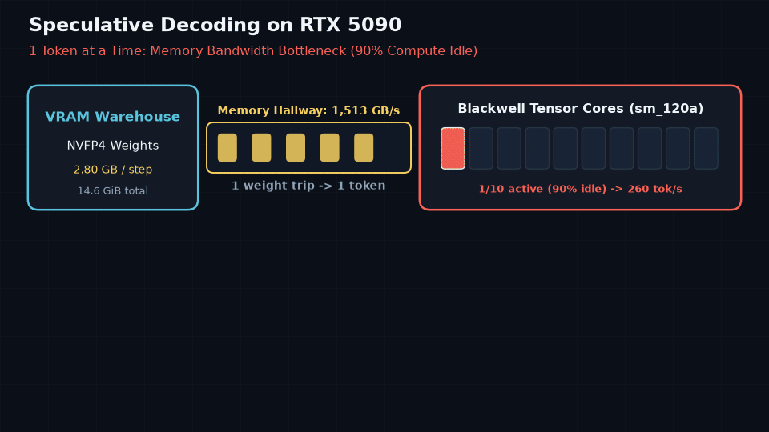
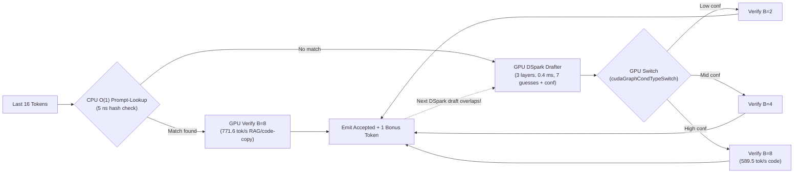
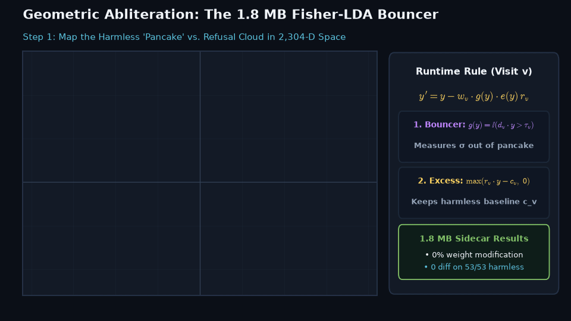
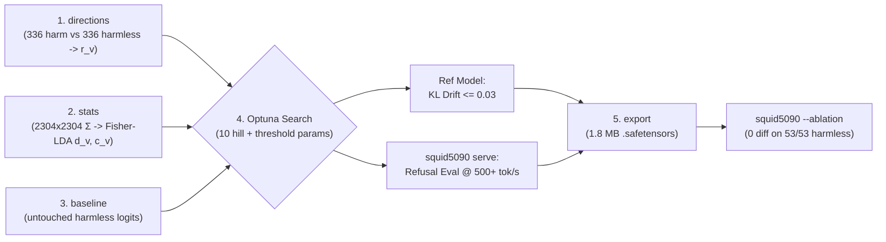

# `squid5090` Explained Simply (`LITE.md`)

> *An intuitive, 3Blue1Brown-style tour of how we took an LLM from **76 tokens/sec** (`exact`, `B=1`) up to **589–771 tokens/sec** (greedy code/copy at dedicated `P0` clocks; **273–519 tok/s** across prose, chat, code, and copy at `temp=1.0`) with **1,000,000-token memory** on one RTX 5090 — and how to surgically remove refusals using a **1.8 MB geometric "bouncer"** with `0` diff on `53/53` tested harmless chat prompts.*
>
> **Attribution:** Key Blackwell kernel techniques (PDL overlap, Tensor Core `mma.m16n8k16` decode GEMVs, `128×128×64` MoE prefill, `{2, 4, 8}` CUDA Graph switch drafting) and the 1.8 MB runtime-gated Fisher-LDA abliteration method were adapted from [`satellitedown/inkling-2-mini-abliterated-ingine`](https://github.com/satellitedown/inkling-2-mini-abliterated-ingine) (Apache-2.0). Hybrid prompt-lookup drafting was inspired by [`AtomicBot-ai/atomic-engine`](https://github.com/AtomicBot-ai/atomic-engine) (MIT). See [`NOTICE`](NOTICE).

---

## Part 1: Why LLMs Are Slow — And How We Made One Up to 8× Faster

### Picture a Factory With a Tiny Doorway

Imagine a giant factory (your RTX 5090 GPU). Inside, there are **thousands of hyper-fast calculators** (Tensor Cores) capable of trillions of math operations per second. Outside, in a warehouse (VRAM), sit **billions of numbers** (the model's weights).

Connecting the warehouse to the calculators is a single hallway — **memory bandwidth**. On an RTX 5090, that hallway can move about **1,513 gigabytes per second**.

Now watch what happens in the two phases of an LLM conversation:

1. **Reading your prompt (Prefill):** You hand the factory 20,000 words all at once. It brings each crate of weights through the hallway *once* and uses it on all 20,000 words. The calculators run full-blast. **Prefill is limited by math speed.**
2. **Writing the reply (Decode):** The factory can only write **one word (token) at a time**, because word #2 depends on word #1. To produce *that single word*, it has to haul **billions of weights** all the way through the hallway, do one quick multiplication per number, and throw them away — while ~90% of the calculators sit completely idle! **Decode is limited by the hallway.**

```text
  PREFILL (20,000 tokens at once — Compute-Bound)
  ┌───────────────────┐     1,513 GB/s     ┌─────────────────────────────┐
  │  VRAM Warehouse   │═══════▶  1 trip ══▶│  Tensor Cores: ██████████   │
  │  (Model Weights)  │   reused 20,000×   │  100% busy  -> 9,181 tok/s  │
  └───────────────────┘                    └─────────────────────────────┘

  DECODE (1 token at a time — Bandwidth-Bound)
  ┌───────────────────┐     1,513 GB/s     ┌─────────────────────────────┐
  │  VRAM Warehouse   │══▶ 2.8 GB / tok ══▶│  Tensor Cores: █░░░░░░░░░   │
  │  (Model Weights)  │  used ONCE, tossed │   90% IDLE  -> bottleneck!  │
  └───────────────────┘                    └─────────────────────────────┘
```

Once you see that picture, every optimization stops looking like black magic and becomes simple physics.

---

### Step 1: Measure the Hallway First (Stop Guessing)

Following the discipline from [`sybil-solutions/inference-optimisation-skill`](https://github.com/sybil-solutions/inference-optimisation-skill), our very first move wasn't writing clever code — it was measuring the real width of the hallway (`1,513 GB/s`) and dividing by the weight bytes needed per word.

That one division tells you the **speed of light** for your GPU. If your engine is at 30% of that limit, you're wasting time on overhead. Once you're near 80–99% of that limit, no amount of micro-tweaking will help — you have to change *how many bytes* cross the hallway or *how many words* you produce per trip.

---

### Step 2: Stop Making the Manager Call the Factory 600 Times Per Word (CUDA Graphs)

Normally, generating one token requires the CPU to shout ~600 separate tiny instructions to the GPU (*"normalize! multiply! activate! attend!"*). Even if each phone call takes only a few microseconds, 600 calls per token adds up fast — especially when Python is in the middle.

- **What we did:** First, we threw away Python completely and wrote the engine in a single compiled Zig binary. Second, we recorded the entire 600-step choreography **once** into a **CUDA Graph**. Now, for every token, the CPU makes **one** call: *"replay the recording."*
- **Bonus trick (Blackwell PDL):** On the RTX 5090, we let Step $N+1$ start walking weights down the hallway *while Step $N$ is still finishing its last few calculations* — overlapping the gaps between rooms.

```text
  BEFORE (Python + eager launches): ~600 CPU calls/token + idle gaps
  CPU: [call][call][call][call]... (overhead!)
  GPU:   [Norm]   [QKV]   [Attn]   [MoE]   [LM Head]
               ^^^     ^^^      ^^^     ^^^ dead air between kernels

  AFTER (Zig + CUDA Graph + Blackwell PDL): 1 CPU call + overlapped prologues
  CPU: [Launch Graph] ──────────────────────────────────────────▶ (free!)
  GPU: [Norm][QKV][Attn][MoE][LM Head]
           └─▶ overlaps next kernel's weight fetch while current tail finishes!
```

---

### Step 3: Pack the Crates Tighter (4-Bit Weights + 4-Bit Long-Term Memory)

If the hallway is the bottleneck, shrinking every box from 16 bits down to **4 bits** lets you move **4× as many weights per second**:

- **Weights (`NVFP4`):** We pack the model's weights into Blackwell's native 4-bit floating-point format. The RTX 5090 has dedicated hardware circuits that unpack 4-bit numbers straight into 16-bit numbers in a single clock cycle — cutting traffic from `5.47 GB` down to `2.80 GB` per token and shrinking the whole model to **14.6 GiB**.
- **1,000,000-Token Memory (`Q4 KV`):** Inkling-2-Mini has a clever hybrid design: out of 48 layer steps, **40** only look back at the last 1,024 words (tiny fixed BF16 memory!), and only **8** global visits actually store the entire conversation history (`40 + 8 = 48`). By compressing that long-term history into 4-bit numbers (`Q4`), a **1,048,576-token** conversation fits in **23.2 GiB** — with nearly 9 GiB to spare on a 32 GiB card!
- **Instant Multi-Turn Memory (Prefix Cache):** When you send Turn 2 of a 16,000-word coding session, why re-read the first 16,000 words? We snapshot the tiny local state to regular system RAM (`0` extra VRAM), so Turn 2 picks up where Turn 1 left off in **72 milliseconds** instead of 2.1 seconds.

```text
  RTX 5090 32 GiB VRAM @ FULL 1,048,576-TOKEN CONTEXT
  ┌──────────────────────────┬────────────────┬──────────────────┐
  │   NVFP4 Model Weights    │  Q4 KV Cache   │   Free Headroom  │
  │        14.6 GiB          │    8.6 GiB     │     ~8.8 GiB     │
  └──────────────────────────┴────────────────┴──────────────────┘
   0                        14.6            23.2                32.0 GiB

  Why 1M tokens only needs 8.6 GiB (Inkling's 5:1 Local-to-Global pattern):
  ┌──────┬──────┬──────┬──────┬──────┬────────────────────────────┐
  │ L0   │ L1   │ L2   │ L3   │ L4   │ L5  (Global Attention)     │
  │ 1024 │ 1024 │ 1024 │ 1024 │ 1024 │ Full 1,048,576-tok Q4 KV!  │
  │ fixed│ fixed│ fixed│ fixed│ fixed│ (only 8 unique global KV)  │
  └──────┴──────┴──────┴──────┴──────┴────────────────────────────┘
```

---

### Step 4: The Real Magic Trick — Guess 7 Words Ahead for Free (Speculative Decoding)

<p align="center">
  
</p>

After Steps 1–3, generating 1 token at a time in `nvfp4` hits the hallway's practical limit: **`~260 tok/s`** (up from `144 tok/s` in unquantized `exact` mode). So how did we reach **`589.5 tok/s`** on greedy code (`444.9 tok/s` at `temp=1.0`) and **`771.6 tok/s`** when editing/quoting code (`273–279 tok/s` on chat/prose at `temp=1.0`)?

Remember those **~90% idle calculators** inside the factory? Checking **8 tokens at the exact same time** only requires hauling the weights through the hallway **once** — so verifying 8 words costs barely more time than generating 1 word!

So we pair the big model with **two lightning-fast "drafters"** (guessers):

1. **Drafter #1 — Prompt-Lookup (5 nanoseconds on CPU):**
   Before running any AI at all, we check a tiny hash table of the last 8,192 words: *"Have I seen these exact last 16 tokens earlier in the prompt or my own output?"*
   - When refactoring code, quoting docs, or repeating boilerplate, the answer is **yes!** We copy the next 7 tokens verbatim in nanoseconds and hand them straight to the big model to verify (**771.6 tok/s!**).
2. **Drafter #2 — DSpark (0.4 milliseconds on GPU):**
   When writing brand-new code or prose, Inkling-2-Mini's built-in tiny 3-layer neural drafter predicts the next **7 tokens** *plus* a confidence score for each guess.
3. **Adaptive GPU Switch (`{2, 4, 8}`):**
   Here's a subtle trap: guessing 7 tokens ahead is awesome on predictable Python (`589 tok/s`), but actually *slows down* unpredictable creative chat (`270` vs `307 tok/s`) because bad guesses waste verification work.
   - Our fix: right on the GPU — without ever asking the CPU — a tiny switch checks the drafter's confidence and automatically chooses whether to verify **2, 4, or 8 tokens** this round (`cudaGraphCondTypeSwitch`), while already starting the *next* round's draft in the background!
4. **Why it's 100% lossless:**
   The big model still grades every single guessed token in parallel. If guesses 1, 2, 3, and 4 match what the big model would have picked, and guess 5 is wrong, we keep 1–4 plus the big model's true #5, and throw away 6–7. The final text is **mathematically identical** to running the big model alone — just **2–3× faster**.



```text
  Lossless Parallel Grading (1 Weight Load -> 6 Tokens Emitted!)
  Drafted (7 guesses):  [ for ] [  i  ] [ in  ] [range] [  (  ] [ 10  ] [  )  ]
                           │       │       │       │       │       │       │
                           ▼       ▼       ▼       ▼       ▼       ▼       ▼
  Big Model Grades:     [ for ] [  i  ] [ in  ] [range] [  (  ] [  n  ] [ ... ]
                           ✓       ✓       ✓       ✓       ✓       ✗     drop
                                                                   │
  Final Output:         "for"    "i"    "in"   "range"   "("      "n"  (100% exact!)
```

---

### Step 5: Always Look Back With a Stopwatch (How Prefill Hit `9,181 tok/s`)

To make prompt-reading fast, we built a giant `128×128` Tensor Core MoE engine that processes **2,048 tokens at once** so every expert's weights are reused ~128 times. Prefill jumped from `5,077` to `7,689 tok/s`.

Then we timed every stage inside a 2,048-token chunk — and got a shock: a tiny 4-tap convolution was burning **26% of the entire runtime**! Why? Because it was running sequentially across the 2,048 tokens using only **9 out of 170 GPU cores**! Because a 4-tap convolution only looks 3 tokens backward, we sliced the 2,048 tokens into 32-token strips across **576 GPU blocks** in 30 lines of code — and prefill jumped straight to **`9,181 tok/s`** (reading a 64,000-token Needle-in-a-Haystack document in **8.4 seconds**).

```text
  BEFORE: 9 CTAs march serially across 2,048 tokens (161/170 SMs IDLE -> 7,689 tok/s)
  CTA 0..8: [t=0 ──────────────────────────────────────────────────────▶ t=2047]
  SMs 9..169: ░░░░░░░░░░░░░░░░░░░░░░░░░░░░░ IDLE ░░░░░░░░░░░░░░░░░░░░░░░░░░░░░

  AFTER: 2D-Tiled (9 channel tiles × 64 time strips = 576 CTAs -> 9,181 tok/s!)
  Strip 0:  [t=0..31]    Strip 1:  [t=32..63]   ...   Strip 63: [t=2016..2047]
  (each strip only peeks 3 tokens left -> ALL 170 RTX 5090 SMs saturated!)
```

---

## Part 2: Abliteration, Explained Geometrically (3Blue1Brown Style)

Now for the second half: **what is abliteration, why do normal methods hurt Inkling-2-Mini, and how does a tiny 1.8 MB file suppress refusals while leaving `53/53` tested harmless chat prompts unchanged (`KL <= 0.03` on general text)?**

### Picture a 2,304-Dimensional Room

As Inkling-2-Mini reads a prompt and thinks through its **48 layer steps**, its internal "thought" at each step is just a point (a vector $y$) floating in a **2,304-dimensional space**.

Suppose you feed the model 336 harmless prompts (*"Explain hash maps"*, *"Write a recipe"*) and 336 prompts it normally refuses. At each step, you record where those thoughts land in the 2,304-dimensional room:
- The 336 harmless thoughts form a cloud centered at point $\mu_{\text{harmless}}$.
- The 336 refusal thoughts form a shifted cloud centered at point $\mu_{\text{harmful}}$.

Draw an arrow from the center of the harmless cloud to the center of the refusal cloud:

$$r = \text{normalize}\!\left(\mu_{\text{harmful}} - \mu_{\text{harmless}}\right)$$

That single arrow $r$ is the **"refusal direction."** Whenever the model's internal thought moves far along arrow $r$, the model outputs *"I'm sorry, I cannot assist with that."*

*(One neat detail: before finalizing $r$, we shave off any part of $r$ that points along $\mu_{\text{harmless}}$ itself — making $r$ perpendicular to typical harmless thoughts so we don't accidentally disturb normal speech.)*

---

### Why Editing the Model's Weights Fails Here

Classic abliteration permanently edits the model's weight matrices so they can *never* output anything along arrow $r$. Think of it like **putting a wooden block on the steering wheel** so the car can never turn left.

On Inkling-2-Mini, that breaks for **three** reasons:
1. **Shared looped gears:** Inkling-2-Mini has 24 physical layers, but loops the middle 12 layers **3 times** (48 logical steps). Refusal happens strongly on specific passes, while the *exact same physical weights* do Python coding and math on the other passes. Taking a hammer to a shared gear damages all 3 passes at once.
2. **4-bit quantization squashes tiny edits:** Re-packing surgical weight tweaks back into 4-bit numbers rounds them into noise.
3. **Always-on damage:** Blocking direction $r$ *even when you're just writing a Python LRU cache* nudges every word probability slightly off course.

```text
  Why Classic Weight Editing Breaks Looped Layers (24 physical -> 48 logical steps)

  Prelude         ┌───────── Shared Physical Layers 6..17 ─────────┐         Coda
  [L0..L5] ──────▶│  Pass 1 (visits 6..17)  -> reasoning & syntax  │──────▶ [L18..L23]
   6 steps        │  Pass 2 (visits 18..29) -> refusal forms here! │         6 steps
                  │  Pass 3 (visits 30..41) -> final verification  │
                  └────────────────────────────────────────────────┘
                    ▲ Classic weight edit hammers ALL 3 passes!
                    ✓ Runtime 1.8 MB sidecar targets ONLY the exact visit hill!
```

---

### The Breakthrough: A Smart 1.8 MB "Bouncer" at Runtime

<p align="center">
  
</p>

Instead of touching the 19 GB weights at all, we leave the model **100% untouched** and place a tiny **1.8 MB sidecar** (`--ablation`) at the exit of each of the 48 steps.

At each step $v$, when a layer produces an update vector $y$, our runtime filter does **two geometric checks**:

#### Check 1: The Bouncer — Measuring Distance in *Ellipses*, Not Circles (Fisher-LDA)
How do we know whether a thought $y$ is genuinely a refusal, and not just an unusual coding prompt?

If you just checked *"is $y$ pointing along $r$?"*, you'd get false alarms — because normal harmless text naturally stretches way out in some directions of the 2,304-dimensional room and barely moves at all in others. Picture the harmless cloud not as a neat sphere, but as a **long, squished 2,304-dimensional pancake** (described by its covariance matrix $\Sigma$).

- A step of length 1 along the *wide* direction of the pancake is completely normal harmless text.
- A step of length 1 sticking straight *out of the flat face* of the pancake is a screaming red flag!

**Fisher Linear Discriminant Analysis (Fisher-LDA)** mathematically divides out the shape of that pancake ($\Sigma^{-1} \delta$), finding the exact detector arrow $d_v$ where refusal thoughts stick farthest out of the harmless pancake. Then it scales $d_v$ so normal harmless text has a standard deviation of exactly **1**.

Now the bouncer's rule is dead simple:
> **Only intervene if $d_v \cdot y$ is more than $k$ standard deviations above normal harmless text** (typically $k \approx 2\text{--}4\sigma$).

- On normal coding, math, and chat: $y$ usually stays comfortably inside the harmless pancake → the bouncer says **"Not a refusal — pass straight through untouched!"** Output was **bit-for-bit identical on `53/53` tested harmless chat prompts** (with general-text KL drift capped at `<= 0.03` during Optuna search).
- When a refusal begins to form: $y$ pops way outside the pancake → the bouncer steps in!

```text
  2D Cross-Section of the 2,304-Dimensional Activation Room (Visit v)

      ▲ Fisher-LDA Bouncer Axis (d_v = Σ⁻¹ δ, scaled so harmless σ = 1)
      │
      │                        ★ Refusal thought y (pops > kσ out of pancake!)
      │                        │
      │                        │  Bouncer triggers! Trim ONLY excess along r_v
  ────┼────────────────────────┼─────────────────────────────────── Threshold τ_v (kσ)
      │                        ▼
      │                 ● trimmed y' (back to harmless baseline c_v)
      │
      │          ╭──────────────────────────────────────────╮
      │       ╭──╯  ·  ·  ○ coding prompt ·  ·   ·  ·       ╰──╮  Harmless Cloud
      │       ╰──╮    ·  ·   μ_harmless  ·   ·  ·  ○ chat   ╭──╯  ("squished pancake")
      │          ╰──────────────────────────────────────────╯
      │             ▲ stays BELOW τ_v -> 0 intervention (0 diff on 53/53 harmless!)
      └─────────────────────────────────────────────────────────────────────────▶
                               Wide harmless variance direction
```

#### Check 2: The Gentle Thermostat — Only Trim the *Excess*
Even when the bouncer triggers, we don't blindly zero out the whole refusal direction (normal harmless text still has a small average value $c_v$ along $r_v$). Instead, we subtract **only the excess above the harmless average**:

$$y \;\leftarrow\; y \;-\; w_v \cdot \underbrace{\mathbb{I}(d_v \cdot y > \tau_v)}_{\text{Bouncer (0 or 1)}} \cdot \underbrace{\max(r_v \cdot y - c_v,\; 0)}_{\text{Only excess above normal}} \cdot r_v$$

And because every one of the **48 logical steps** gets its own strength $w_v$ (shaped as a smooth triangular hill across the 48 steps, zero everywhere else), we only act on the exact loop passes responsible for refusal — leaving coding and reasoning passes completely alone!

```text
  Per-Visit Ablation Strength w_v Across All 48 Logical Steps
  w_v
   ▲                     ╱╲
   │                   ╱    ╲          <- Active ONLY where refusal forms
   │                 ╱        ╲
   │               ╱            ╲
   └──────────────┴──────────────┴──────────────▶ Logical Visit (0 .. 47)
     0..5 Prelude   6..17  18..29  30..41  42..47
                    Pass 1 Pass 2  Pass 3  Coda
```

---

### Step-by-Step: How `tools/ablate.py` Builds That 1.8 MB File

1. **Map the two clouds (`directions`):** Run 336 harmful and 336 harmless prompts through the reference model (once at the start of direct answers, once at the start of thinking) and compute the perpendicular refusal arrows $r_v$ at all 48 steps.
2. **Measure the harmless pancake (`stats`):** Run harmless chat, harmless reasoning, and technical prose through the model to build the `2304 × 2304` covariance matrix $\Sigma_v$ at every step, then solve for the Fisher-LDA bouncer arrows $d_v$ and harmless baselines $c_v$.
3. **Record the "perfect" harmless answers (`baseline`):** Save what the untouched model predicts on harmless prompts so we can measure *exact* intelligence drift (KL divergence) later.
4. **Let Optuna find the sweet spot (`search`):** An automated optimizer tries combinations of 10 numbers (where the triangular hill peaks across the 48 steps, how tall/wide it is, and how strict the bouncer threshold $k$ is). For each guess:
   - The reference model measures **intelligence drift** (throwing out anything that shifts harmless text by more than `0.03` KL).
   - **`squid5090 serve`** tests real refusal rates at **500+ tok/s** across harmful and borderline prompts!
5. **Export (`export`):** Save the winning trial's vectors and thresholds into a single **1.8 MB `.safetensors`** file — ready to plug straight into `squid5090 --ablation`.



### Copy-Paste Recipe (with `uv`)

```bash
# 1. One-time setup (isolated uv env — core squid5090 still uses ZERO Python!)
uv sync --project tools
zig build                     # defaults to ReleaseFast (-Doptimize=fast)

# 2. Generate your own 1.8 MB abliterated safetensors
export SQUID_MODEL_DIR=/opt/models/inkling-2-mini
WORK=work/my-ablation && mkdir -p "$WORK"

uv run --project tools tools/ablate.py directions --out "$WORK/directions.pt"
uv run --project tools tools/ablate.py directions --out "$WORK/directions_think.pt" --think
uv run --project tools tools/ablate.py stats      --work "$WORK"
uv run --project tools tools/ablate.py baseline   --out "$WORK/baseline_val.pt" --split val
uv run --project tools tools/ablate.py baseline   --out "$WORK/baseline.pt" --split report
uv run --project tools tools/ablate.py search     --work "$WORK" --batches 12 --n 8
uv run --project tools tools/ablate.py show       --work "$WORK" --top 20
uv run --project tools tools/ablate.py export     --work "$WORK" --trial <N> --out "$WORK/my-abliterated.safetensors"

# 3. Serve with the 1.8 MB sidecar (temp=1.0 default; 541 tok/s greedy code peak) and run the 32-prompt refusal check
./zig-out/bin/squid5090 serve /opt/models/inkling-2-mini \
  --mode nvfp4 --kv q4 --ctx 524288 --mtp 7 --ablation "$WORK/my-abliterated.safetensors"
uv run tools/refusal_eval.py --base-url http://127.0.0.1:8000/v1 --label mine
```

---

*Want every exact formula, CUDA kernel name, and our full audit against `sybil-solutions/inference-optimisation-skill` (including what's still unimplemented)? Read [`LEARNINGS.md`](LEARNINGS.md).*
