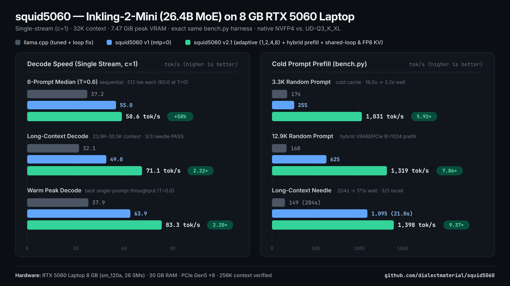

# squid5060

**A single-binary, zero-Python TigerStyle Zig + Blackwell CUDA (`sm_120a`) inference engine and OpenAI-compatible HTTP/SSE server for [`thinkingmachines/Inkling-2-Mini`](https://huggingface.co/thinkingmachines/Inkling-2-Mini) (26.4B looped MoE) — engineered for 8 GB Blackwell GPUs (RTX 5060 Laptop / Desktop, `sm_120a`).**

Forked from [`tensorfish/squid5090`](https://github.com/tensorfish/squid5090), `squid5060` brings native NVFP4 Blackwell PTX inference, persistent CUDA Graphs, **4-way `{1, 2, 4, 8}` adaptive DSpark speculative decoding + Hybrid O(1) Prompt-Lookup**, **tail-aliased `B=1024` hybrid VRAM/PCIe Tensor Core prefill**, **FP8 local SWA + shared-loop Q4 global KV caches**, and **up to 256K context** into **< 7.5 GiB VRAM** — beating tuned `llama.cpp` (`UD-Q3_K_XL` + MoE-cache loop dedup) by **+58–122% on single-stream decode** and **5.9×–9.4× on cold prefill**.



> **Upfront Attribution:** `squid5060` tracks [`tensorfish/squid5090`](https://github.com/tensorfish/squid5090) (which builds on [`satellitedown/inkling-2-mini-abliterated-ingine`](https://github.com/satellitedown/inkling-2-mini-abliterated-ingine), [`AtomicBot-ai/atomic-engine`](https://github.com/AtomicBot-ai/atomic-engine), and [`sybil-solutions/inference-optimisation-skill`](https://github.com/sybil-solutions/inference-optimisation-skill)). Training-free last-loop KV sharing was inspired by [2DSD (SqueezeAILab)](https://github.com/SqueezeAILab/2DSD). Full attributions live in [`NOTICE`](NOTICE).
>
> **Deep Dives (from upstream `squid5090`):** [`LITE.md`](LITE.md) · [`LEARNINGS.md`](LEARNINGS.md) · [`THEORY.md`](THEORY.md)

---

## Measured RTX 5060 Laptop (8 GB) Benchmarks vs. `llama.cpp`

Measured strictly single-stream (`c=1`, sequential — zero multi-user batching) on an **NVIDIA GeForce RTX 5060 Laptop GPU** (`sm_120a`, 26 SMs, 32 MiB L2, 7.8 GiB usable VRAM, PCIe Gen5 x8) using the exact same OpenAI-SSE `bench.py` harness (6 diverse prompts × 512 decode, cold 3.3K & 12.9K random-filler prefill, long-context Needle-in-a-Haystack retrieval, continuous `nvidia-smi` peak VRAM probe):

| Metric (`c=1`, RTX 5060 Laptop 8 GB) | `llama.cpp` `ink-dedup` (`UD-Q3_K_XL`, `T=0.6`) | `squid5060` v1 (`--mtp 0`) | **`squid5060` v2.1 (`T=0.6` exact match)** | **`squid5060` v2.1 (`T=0.0` greedy)** | **v2.1 Gain vs. `llama.cpp`** |
|---|---:|---:|---:|---:|---:|
| **6-prompt `c=1` decode median** | `37.2 tok/s` | `55.0 tok/s` | **`58.6 tok/s`** *(up to `67.6`)* | **`60.0 tok/s`** *(up to `70.4`)* | **+58% (`T=0.6`) / +61% (`T=0`)** |
| **Warm single-prompt decode (`T=0.0`)** | `37.9 tok/s` | `63.9 tok/s` | — | **`77.5–80.6 tok/s`** *(peak **`83.3`**)* | **2.20× faster** |
| **Cold prefill (3.3K random filler)** | `174 tok/s` | `255 tok/s` | **`981 tok/s`** | **`1,031 tok/s`** | **5.64× – 5.92× faster** |
| **Cold prefill (12.9K random filler)** | `168 tok/s` | `625 tok/s` | **`1,319 tok/s`** | **`1,315 tok/s`** | **7.86× faster** |
| **Long-ctx Needle prefill** | `149 tok/s` *(204s)* | `1,095 tok/s` *(21.8s)* | **`1,398 tok/s`** *(17.1s)* | **`1,392 tok/s`** *(17.2s)* | **9.37× faster** |
| **Long-ctx Needle decode** | `32.1 tok/s` | `49.0 tok/s` | **`68.4 tok/s`** | **`71.1 tok/s`** | **2.13× – 2.22× faster** |
| **Needle-in-a-Haystack accuracy** | `3/3` | `3/3` PASS | **`3/3` PASS** | **`3/3` PASS** | **100% exact** |
| **Peak VRAM (`nvidia-smi`, incl. desktop)** | `7.35 GiB` | `7.47 GiB` | **`7.47 GiB`** *(1,471/3,072 experts)* | **`7.47 GiB`** *(1,471/3,072 experts)* | **Under 7.5 GiB** |
| **128K context (`--ctx 131072 --kv q4`)** | — | 1,156 experts | **1,352 experts (`7.25 GiB`, `0.82 GiB` runtime)** | — | **+196 experts vs v1** |
| **256K context (`--ctx 262144 --kv q4`)** | — | — | **1,192 experts (`7.25 GiB`, `1.48 GiB` runtime)** | — | **Fits 256K in 8 GB** |

- **Quality verified:** Exact FP64 KLD on `--raw` `tools/kld_corpus.txt`:
  - FP8 local SWA + Q4 global KV vs. BF16 local KV: `mean_KLD = 0.009121`, `top1 = 97.20%`, `dPPL = -0.0298`.
  - Training-free Last-Loop KV Sharing (`W=1,024` native tail window on Layers 11 & 17, 3,026 tokens — 3× past the local window) vs. native per-loop KV: **`mean_KLD = 0.006537`, `med = 0.000000`, `top1 = 98.65%`, `dPPL = -0.0105`**, plus `3/3` verbatim 23.9K needle retrieval.
- **Stochastic sampling (`--temp 1.0 --top-p 0.95`):** Uses exact Leviathan/Chen rejection sampling with residual resampling inside the CUDA Graph (zero-overhead GPU sampling matching Inkling-2-Mini's official `generation_config.json`).

---

## Architecture: How `squid5060` Fits 26.4B + 256K Context into 8 GB VRAM

Full `Inkling-2-Mini` weights are ~14.54 GiB in NVFP4 — nearly double an 8 GB GPU's VRAM. On any GPU with `< 15 GiB` VRAM, `squid5060` automatically enables its **8 GB Unified Expert Cache** profile (`--mode nvfp4 --kv q4 --ctx 32768 --mtp 7 --spec-threshold 0.90 --embed-host`) while keeping full-VRAM mode and dynamic SM-aware grids for larger Blackwell GPUs (`>= 15 GiB`):

1. **Unified 3,072-Expert VRAM Cache (`~6.1–6.5 GiB`, 1,471–1,529 physical slots at 32K):**
   - All 24 physical layers' 3,072 experts (L0–19 native NVFP4 + L20–23 converted from MXFP8 → NVFP4 on load in 32-expert GPU chunks) are packed into a uniform `4,478,976 B` (`4.27 MiB`), 256-byte-aligned slot (`w13_data`, `w13_scales`, `w2_data`, `w2_scales`).
   - **Automatic 3× loop deduplication:** Inkling-2-Mini loops layers `6..17` three times per token (48 logical visits over 24 physical layers). Global Aging-LFU (`LRFU`, `decay=0.998`, `hyst=1.50`) naturally prioritizes the 3×-looped middle layers — achieving **~94–96% hit rate** across the 36 looped visits with zero manual per-layer budgets.
   - **Zero-race async overlapped promotion:** Dedicated `copy_stream` overlaps H2D promotions with the next forward pass using 8 staging slots and 1-token victim quarantine while keeping persistent `cudaGraphExec_t` graphs completely intact.
   - **Warm-cache snapshot (`.squid5060-warm-cache.bin`):** 12 KiB LRFU snapshot bulk-DMAs ~1,460 hot experts in ~260 ms on startup (`--cache-file` / `--no-warm-cache`).
2. **Dual-Path CTA-Uniform Decode MoE Kernels (96% of PCIe Gen5 x8 Ceiling):**
   - `cslot = __ldg(slot_map + expert)` is uniform per CTA (`1 expert per CTA`).
   - **VRAM Hit (`cslot >= 0`):** Zero-SMEM `uint2` path (**>740–1,270 GB/s** across L2+GDDR7).
   - **PCIe Miss (`cslot < 0`):** 1-burst coalesced SMEM scale preload + `uint4` weight bursts hitting **23.7–23.9 GB/s** directly from pinned host RAM (**96% of the 24.8 GB/s PCIe Gen5 x8 DMA ceiling**).
   - Surrounding dense attention, QKVRG, and `lm_head` layers use upstream's Blackwell `mma.m16n8k16` Tensor Core + PDL kernels with **dynamic SM-aware grid sizing** (`cudaDevAttrMultiProcessorCount` → `208`/`104` blocks on 26-SM RTX 5060, scaling automatically up to `1024`/`512` on RTX 5090).
3. **Hybrid VRAM/PCIe `B=1024` Tensor Core Prefill (19× PCIe Miss Speedup, `0.0 MiB` Permanent VRAM):**
   - **Blackwell `cp.async` PCIe discovery:** `cp.async.cg/ca.shared.global` silently drops to ~1 GB/s on `cudaHostAllocMapped` PCIe host memory. `p_wgemm_kernel<..., CACHED=true>` keeps `cp.async` for VRAM hits (`cslot >= 0`) and switches PCIe misses (`cslot < 0`) to coalesced `uint4` (`__ldg`) loads — yielding a **19× speedup** (`12.5 s → 667 ms` per `B=1024` chunk, **`0.00000000` bit-exact parity**), pushing cold prefill to **`981–1,398 tok/s`**.
   - **Prefill-scratch tail aliasing:** `B=1024` prefill scratch (`375.9 MiB`) is lazily borrowed from 88 evictable tail slots of `ExpertCache` during prefill and immediately returned into the cache free-list for decode — **`0.0 MiB` permanent decode overhead**!
4. **FP8 Local SWA KV + Training-Free Last-Loop Shared Global KV (50% Global KV Reduction):**
   - All 40 local sliding-window attention visits use FP8 E4M3 KV + per-head-token FP16 scales (`SQUID_LOCAL_KV_BF16=1` override), reclaiming `+98.4 MiB` VRAM (`+23` experts).
   - On the two 3×-looped global attention layers (Layers 11 & 17, which account for 6 of the 8 global KV banks), Loops 1 & 2 keep a full **1,024-token native per-loop tail ring** (`1088` slots) and share Loop 3's bulk global KV bank for history beyond 1,024 tokens (`SQUID_SHARE_LOOP_KV=0` override). Zero extra kernels or copies, **`0.0065` KLD / `98.65%` top-1**, and cuts global KV banks **8 → 4** (`+31` experts at 32K, `+127` experts at 128K, **256K fits in 8 GB**!).
5. **4-Way `{1, 2, 4, 8}` Adaptive CUDA Conditional Switch + Hybrid O(1) Prompt-Lookup:**
   - Unlike 32 GB GPUs where `B=2` is nearly free, verifying a low-confidence draft token on an 8 GB GPU incurs extra PCIe misses. Adding a `width = 1` branch to CUDA 13's `cudaGraphCondTypeSwitch` lets uncertain steps drop cleanly to `B=1` while confident code/verbatim spans scale up to `B=2 / 4 / 8` — eliminating prose regressions while peaking at **80–83 tok/s**.

---

## Quickstart

### Requirements
- **OS:** Linux x86_64
- **GPU:** NVIDIA Blackwell GPU (`sm_120a`, e.g., RTX 5060 8 GB / RTX 5070 / RTX 5090)
- **CUDA Toolkit:** CUDA `13.0+` (`nvcc`, `libcudart`, `libcublas` — auto-detects `/opt/cuda` or `/usr/local/cuda`, overridable via `-Dcuda-path=...`)
- **Build Tools:** `g++`, **Zig `0.17.1+`**
- **Model:** [`thinkingmachines/Inkling-2-Mini`](https://huggingface.co/thinkingmachines/Inkling-2-Mini) (~20.2 GB safetensors)

### Build & Run
```bash
git clone https://github.com/dialectmaterial/squid5060.git
cd squid5060

# Build ReleaseFast binary at zig-out/bin/squid5060 (auto-detects /opt/cuda or /usr/local/cuda)
zig build

# Download official Inkling-2-Mini safetensors
hf download thinkingmachines/Inkling-2-Mini --local-dir /path/to/inkling-2-mini

# Start OpenAI-compatible HTTP/SSE server (auto-configures 8 GB profile: nvfp4, q4/fp8/shared KV, ctx=32768, mtp=7, thr=0.90)
./zig-out/bin/squid5060 serve /path/to/inkling-2-mini --host 127.0.0.1 --port 8000

# Optional: bearer auth from a mode-600 key file (never passed in process argv)
./zig-out/bin/squid5060 serve /path/to/inkling-2-mini --host 127.0.0.1 --port 8000 --api-key-file /path/to/api-key

# One-shot CLI generation / benchmark
./zig-out/bin/squid5060 generate /path/to/inkling-2-mini \
  --prompt "Write a clean Python implementation of Dijkstra's shortest path algorithm." \
  --max-tokens 512 --ctx 32768 --mtp 7 --spec-threshold 0.90

./zig-out/bin/squid5060 bench /path/to/inkling-2-mini \
  --prompt "Write a clean Python implementation of Dijkstra's shortest path algorithm." \
  --max-tokens 256 --runs 3 --ctx 32768 --mtp 7 --spec-threshold 0.90

# 128K or 256K context scaling in 8 GB VRAM
./zig-out/bin/squid5060 longctx /path/to/inkling-2-mini --ctx 131072 --kv q4
./zig-out/bin/squid5060 longctx /path/to/inkling-2-mini --ctx 262144 --kv q4
```

*(Optional draft speedup: if a flat little-endian `int32` `draft_vocab_32k.bin` or `draft_vocab_49k.bin` token-ID table is placed in the model directory, `squid5060` automatically prunes the DSpark draft LM head from 200K → 32K, saving ~245 MiB VRAM (+57 cached experts) and speeding up drafting ~4×. Without it, or with `SQUID_DRAFT_VOCAB=full`, `squid5060` seamlessly uses the full 200K draft vocabulary.)*

### Key CLI Flags & Overrides

| Flag / Env | Default (`< 15 GiB` `serve`) | Description |
|---|---|---|
| `--mode` | `nvfp4` (`fp8` on ≥15 GiB) | Weight precision: `nvfp4` \| `fp8` \| `exact` (`exact` requires `--no-expert-cache`) |
| `--kv` | `q4` (`auto` on ≥15 GiB) | Global KV cache format: `q4` \| `fp8` \| `bf16` (`SQUID_LOCAL_KV_BF16=1` disables FP8 local SWA; `SQUID_SHARE_LOOP_KV=0` disables last-loop global KV sharing) |
| `--ctx` | `32768` (up to `262144` in 8 GB) | Context window size |
| `--mtp` | `7` (`0` = off) | DSpark speculative drafter (`7` = 4-way adaptive `{1,2,4,8}` CUDA switch + Prompt-Lookup) |
| `--spec-threshold` | `0.90` (`0.80` on ≥15 GiB) | Markov confidence threshold for adaptive verify width (`0.0` = fixed `B=8`) |
| `--temp` / `--top-p` / `--top-k` | `1.0` / `0.95` / `0` | GPU sampling & exact Leviathan/Chen rejection sampling defaults (overridable per-request) |
| `--api-key` / `--api-key-file` | `$SQUID_API_KEY` | Optional `Authorization: Bearer <key>` constant-time auth (rejects empty/oversized key files) |
| `--cache-mib` / `--cache-headroom-mib` | auto / `160` | Override VRAM expert cache size or reserved desktop headroom |
| `--cache-file` / `--no-warm-cache` | `<model_dir>/.squid5060-warm-cache.bin` | Warm-cache LRFU snapshot path or disable snapshot loading/saving |
| `--ablation` | none | Optional 1.8 MB runtime-gated Fisher-LDA `.safetensors` (see [`tools/ablate.py`](tools/ablate.py)) |

---

## License & Documentation

- **[`LICENSE`](LICENSE)** / **[`NOTICE`](NOTICE)** — Apache-2.0 license and complete open-source attributions.
- **[`deploy/squid5060.service`](deploy/squid5060.service)** — Systemd service unit template.
- **[`LITE.md`](LITE.md)** / **[`LEARNINGS.md`](LEARNINGS.md)** / **[`THEORY.md`](THEORY.md)** — Architecture and roofline guides.
